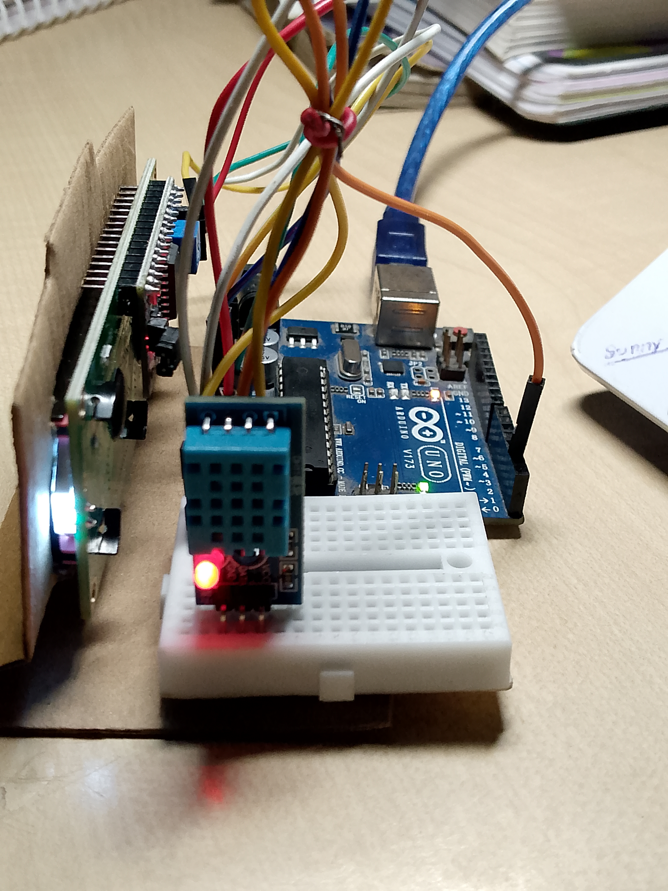
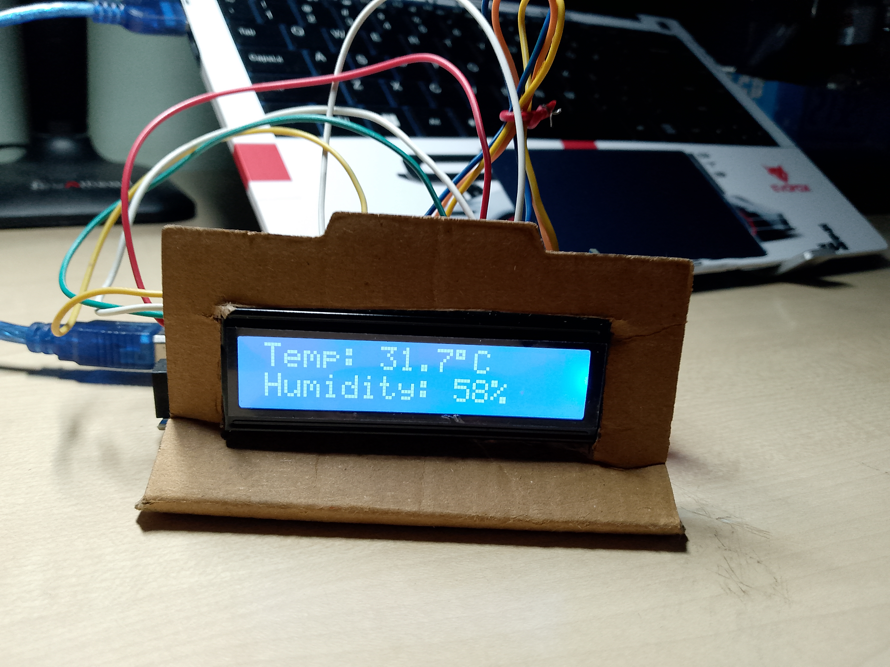

* [Arduino Weather Station]

My first Arduino project that measures **temperature and humidity** using a DHT11 sensor and displays the readings on a **16×2 I²C LCD**.

* [Project Overview]

This is my first embedded systems project. The system continuously reads temperature and humidity from the DHT11 sensor and displays the real-time values on the LCD.

The same sensor readings are also printed to the Arduino Serial Monitor for debugging and monitoring.

* [Components Used]

- Arduino Uno R3
- DHT11 Temperature & Humidity Sensor
- 16×2 LCD with I²C module
- Breadboard
- Jumper wires
- USB cable

* [Circuit Connections]

 . DHT11 → Arduino Uno

| DHT11 | Arduino Uno |

| VCC | 5V |
| DATA | D2 |
| GND | GND |

 * [I²C LCD → Arduino Uno]

| LCD | Arduino Uno |

| VCC | 5V |
| GND | GND |
| SDA | A4 |
| SCL | A5 |

 *How It Works
The DHT11 sensor measures:
- Temperature
- Relative humidity

The Arduino reads these values every 2 seconds and sends them to:

1. The 16×2 I²C LCD
2. The Serial Monitor

 * [Software & Libraries]

- Arduino IDE
- Arduino C/C++
- Wire library
- LiquidCrystal_I2C library
- DHT sensor library

 *Output
The LCD displays information similar to:
->text
Temp: 28.5°C
Humidity: 62%
```

The Serial Monitor also prints the sensor readings at 9600 baud.

 * [Future Improvements]
Planned improvements for this project include:

- ESP32-based Wi-Fi connectivity
- Web-based weather dashboard
- Remote monitoring
- Data logging
- Additional environmental sensors

->  (Project Photos)

       Complete Weather Station
 IMG_20261014_193234_448.jpg
       Hardware Setup

       LCD Display


 -> What I Learned
Through this project I learned the basics of:
- Arduino programming
- I²C communication
- LCD interfacing
- Basic embedded-system debugging
- Hardware wiring and testing

->[Author]
Sunny Rao
This project was created as part of my hands-on learning journey in **Embedded Systems and Electronics**.
