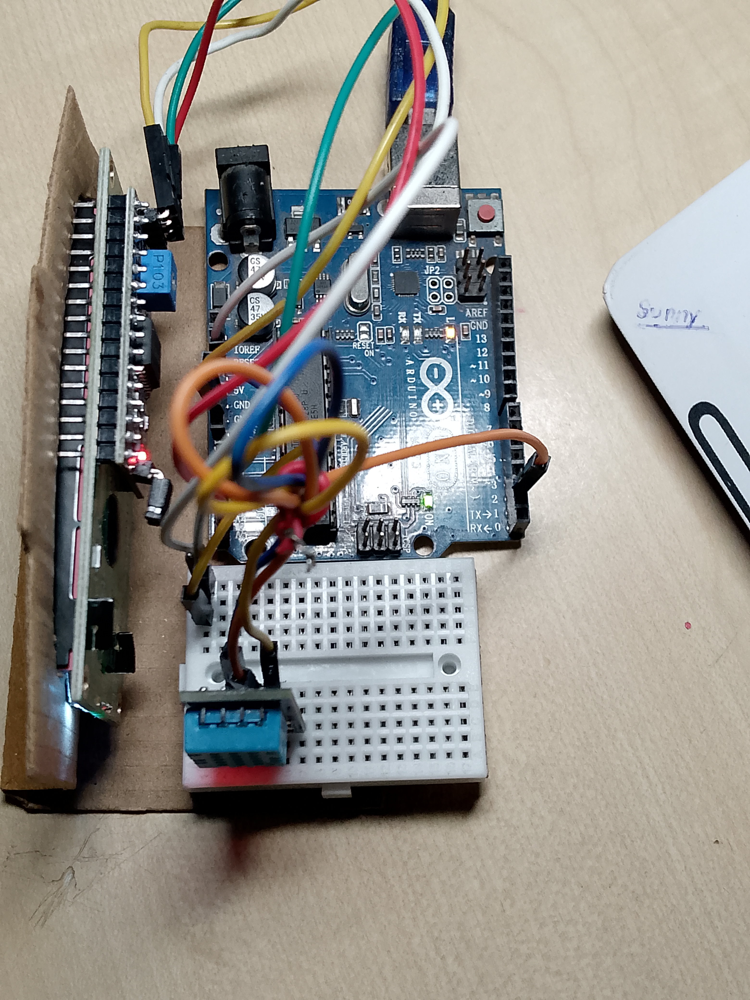

 # Arduino Weather Station
My first Arduino project that measures **temperature and humidity** using a DHT11 sensor and displays the readings on a **16×2 I²C LCD**.

## Project Overview
This is my first embedded systems project. The system continuously reads temperature and humidity from the DHT11 sensor and displays the real-time values on the LCD.
The same sensor readings are also printed to the Arduino Serial Monitor for debugging and monitoring.

## Components Used

- Arduino Uno R3
- DHT11 Temperature & Humidity Sensor
- 16×2 LCD with I²C module
- Breadboard
- Jumper wires
- USB cable

## Circuit Connections
 [I2C LCD -> Arduino uno]
```
   GND = GND
   VCC = 5V
   SDA = A4
   SCL = A5
```
  [DHT11 -> Arduino Uno]
```
   Data = D2
   VCC  = 5V
   GND  = GND
```
   ## How It Works
The DHT11 sensor measures:
- Temperature
- Relative humidity

The Arduino reads these values every 2 seconds and sends them to:
1. The 16×2 I²C LCD
2. The Serial Monitor

## Software & Libraries

- Arduino IDE
- Arduino C/C++
- Wire library
- LiquidCrystal_I2C library
- DHT sensor library

## [C++]
```
#include <Wire.h>
#include <LiquidCrystal_I2C.h>
#include <DHT.h>

#define DHTPIN 2
#define DHTTYPE DHT11

// Use 0x3F instead if that was your working LCD address.
LiquidCrystal_I2C lcd(0x27, 16, 2);
DHT dht(DHTPIN, DHTTYPE);

void setup() {
  Serial.begin(9600);

  lcd.init();
  lcd.backlight();
  dht.begin();

  lcd.setCursor(0, 0);
  lcd.print("Weather Station");
  lcd.setCursor(0, 1);
  lcd.print("Starting...");
  delay(2000);
  lcd.clear();
}

void loop() {
  float temp = dht.readTemperature();
  float humidity = dht.readHumidity();

  if (isnan(temp) || isnan(humidity)) {
    lcd.setCursor(0, 0);
    lcd.print("Sensor error    ");
    lcd.setCursor(0, 1);
    lcd.print("Check wiring    ");
    Serial.println("DHT11 reading failed");
    delay(2000);
    return;
  }

  lcd.setCursor(0, 0);
  lcd.print("Temp: ");
  lcd.print(temp, 1);
  lcd.write((uint8_t)223);
  lcd.print("C   ");

  lcd.setCursor(0, 1);
  lcd.print("Humidity: ");
  lcd.print(humidity, 0);
  lcd.print("%   ");

  Serial.print("Temperature: ");
  Serial.print(temp);
  Serial.print(" C | Humidity: ");
  Serial.print(humidity);
  Serial.println(" %");

  delay(2000);
}
```
 ## Output
The LCD displays information similar to:
->text
Temp: 31.7°C
Humidity: 58%

 ## Project Photos
### Photo 1


### Photo 2


### Photo 3

